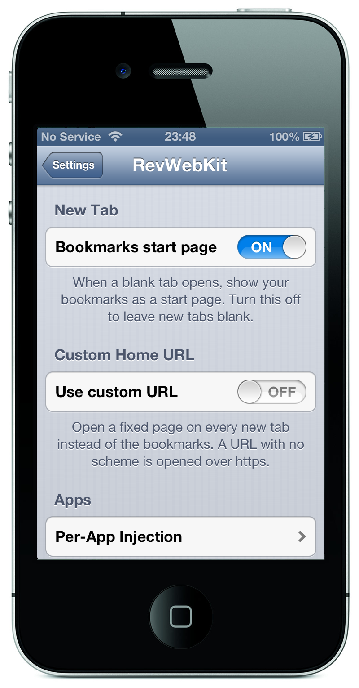

# What works, and the Settings pane

The engine the phone ships with is WebKit 536 from 2012. It cannot render a page written this decade, and it cannot negotiate TLS with a current server. Each of those is fixed here, and the features are listed below, with the Settings pane.

## What works

- **Current WebKit**, built from source for armv7 with a 6.0 deployment target: current C++ compiled for a 2011 phone.
- **Real Mobile Safari on the new engine.** A MobileSubstrate tweak re-launches Safari with the engine forced
  underneath it; the user agent reports `AppleWebKit/605` instead of the stock `536`. UIKit's own gestures, scrolling
  and text selection are reused unchanged.
- **JavaScript with a JIT.** Upstream deleted the ARMv7 JIT; it is restored here, with the regressions that restoring it
  caused fixed as well ([the JIT](../../explanation/webkit/armv7-jit.md)).
- **TLS 1.2 and 1.3.** The system's TLS is from 2012 and current servers refuse its cipher suites. The port answers the
  system's TLS calls over OpenSSL, so the browser reaches sites the phone otherwise cannot open. Certificate
  verification is unchanged: the chain is evaluated by the system as a real `SecTrustRef`
  ([network](../../explanation/webkit/network.md)).
- **Web Crypto**, performed by WebKit's own OpenSSL backend rather than the Cocoa one, which works in CryptoKit and has no
  armv7 Swift: digests, HMAC, AES in GCM, CBC, CFB and CTR, AES key wrapping, HKDF, PBKDF2, ECDSA, ECDH, RSA-OAEP and
  RSASSA-PKCS1, all verified on the device.
- **WebAssembly** (via a bundled interpreter, since JSC's WASM is 64-bit only), **Web Notifications**, **getUserMedia**
  (camera and microphone), `<video>` MediaStream preview, and a wave of self-contained web APIs enabled by default.
- **WebGL.** `canvas.getContext("webgl")` returns a real context: shaders compile, and the GPU draws. Upstream's only GL
  backend goes through ANGLE's Metal renderer, which needs an A7, so this port carries an ANGLE backend on EAGL, the
  GLES API this hardware does have. WebGL 2.0 needs OpenGL ES 3.0 and this silicon is an ES 2.0 part; that is a ceiling,
  not a milestone ([WebGL](../../explanation/webkit/webgl.md)).
- **Web fonts and form controls.** Both were entirely absent rather than approximate: no `@font-face` had ever loaded a
  font in any format, and every button, field, checkbox and select was painted in a fully transparent colour. Sites now
  draw with their own typefaces and their controls can be read.
- **Scrolling inside a page.** Overflow blocks and frames are scrolled by the system's own `UIWebOverflowScrollView`, the
  way this release of iOS does it, which is what makes cookie dialogs and any other inner scroller usable.
- **The image formats the web actually serves.** WebP is decoded by WebKit's own decoder, since this ImageIO cannot. The
  formats that remain undecodable are no longer advertised to servers, which had been negotiating pictures the browser
  could not render.
- **Colour, measured rather than eyeballed.** Gradients interpolate premultiplied, every blend mode including the four
  non-separable ones is reached through CoreGraphics, and SVG filters interpolate in linear light and read back the
  numbers the specification asks for. This graphics library matches colour spaces by primaries and ignores transfer
  functions, so the engine performs those conversions itself, the way ports without colour management do.
- **Joined emoji shape as one glyph.** An astronaut, a family, a skin tone: one glyph each rather than their parts. What
  the device can *draw* is a question about the font it has, and the font stays where it is.
- **A native Settings pane** (`RevWebKit`), described below.

Correctness is checked by a numeric suite that runs on the device and reads pixels, glyph widths and the platform surface
rather than screenshots: `tests/device/run.lua`, currently **57 of 57**. Alongside it, `tests/device/sweep.lua` loads
real sites and reports whether each one survived, painted, and what it cost in memory. Both are described in
[the device suite](device-suite.md).

## The Settings pane

Installed as **`RevWebKit`** in the system Settings app, as a real PreferenceBundle. It writes the
`space.kern0x1b.rev` preferences domain that the engine reads:

- **Bookmarks start page.** A blank tab renders your Safari bookmarks as tiles. Turning it off collapses the rest.
- **Custom Home URL.** Open a fixed page on every new tab instead. A URL with no scheme is opened over `https`.
- **Per-App Injection.** A list of installed apps; the engine is injected only into the ones turned on (Safari by
  default). Injecting the engine into an arbitrary app is experimental and reversible: turn it off and respring.
- **Respring.** Restart SpringBoard from the pane.

  

