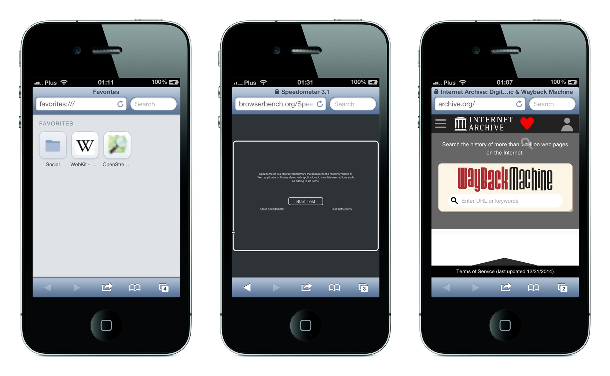

# Revenant WebKit

**A current WebKit for hardware the web left for dead.**

A modern WebKit engine, built from source for **armv7**, running today's websites on an **iPhone 4S from 2011**: a dual-core 800 MHz phone with 512 MB of RAM, on **iOS 6.1.3**. The engine is dropped underneath the phone's own **Mobile Safari**, so the stock browser renders the modern web with none of its own UI replaced.



The engine the phone ships with is WebKit 536 from 2012. It cannot render a page written this decade, and it cannot negotiate TLS with a current server. Each of those is fixed here; the [features](../../docs/reference/webkit/features.md) are listed with the Settings pane.

## Build and deploy

The port is a member of revenant, built from the top of the checkout:

```sh
./xmakew f -P . -p iphoneos -a armv7
./xmakew -P .
./xmakew deb -P .
```

The requirements, the whole sequence and the install on the phone are in [build and test](../../docs/guides/webkit/build-and-test.md). The engine is upstream WebKit at a commit of `main` plus the port's patch series, `packages/w/webkit/patches`. Every document is in [the index](../../docs/README.md).

## License

MIT, see [`LICENSE`](LICENSE), for the code in this repository. The engine keeps WebKit's terms (LGPL-2.1-or-later and BSD-2-Clause), and [third-party](../../docs/reference/webkit/third-party.md) lists every dependency and its licence.

Built with Claude (Anthropic). This project is developed with AI assistance, openly; see the commit history.
